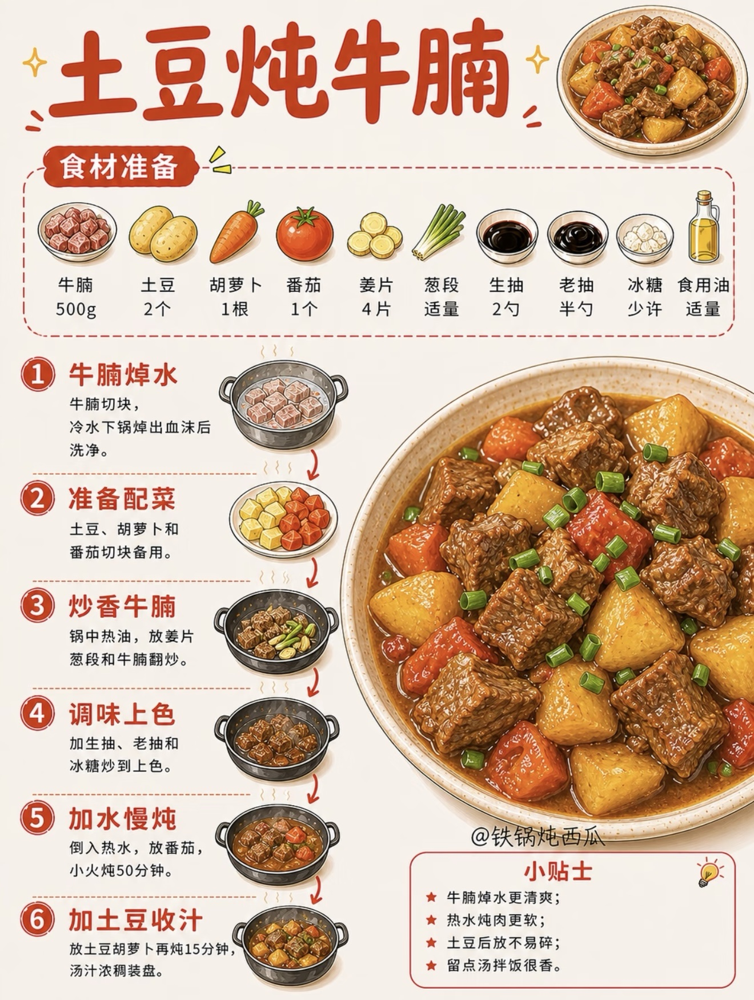

{width=70% fig-align="center"}

## 食材

| 食材 | 用量 |
  |---|---|
  | 牛腩 | 500g |
  | 土豆 | 2-4个 |
  | 胡萝卜 | 1-2个 |
  | 番茄 | 4个 |  
  | 姜片 | 4个 |
  | 葱段 | 适量|
  | 生抽 | 2勺 |
  | 老抽 | 半勺 |
  | 冰糖 | 少许 |
  | 食用油 | 适量 |
  
## 做法
  
  1️⃣ 牛腩焯水：牛腩切块，冷水下锅焯出血沫后洗净。 

  2️⃣ 准备配菜：土豆，胡萝卜和番茄切块备用。  
  
  3️⃣ 炒香牛腩：锅内热油，放姜片，老抽和冰糖，翻炒至牛腩均匀上色。   

  4️⃣ 加水慢炖：倒入热水，放入番茄，小火炖50分钟。   
  
  5️⃣ 加土豆收汁：放入土豆和胡萝卜再炖15分钟，汤汁浓稠即可装盘。 

 