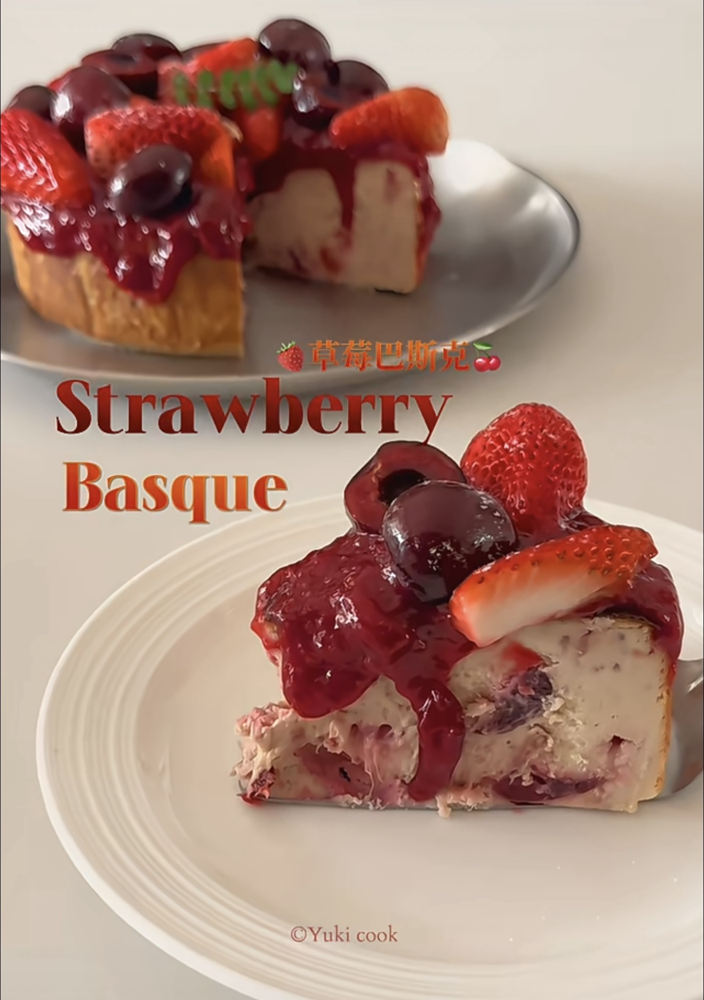

{width=70% fig-align="center"}

## 食材

| 食材 | 用量 |
  |---|---|
  | 草莓 | 1-2盒 |
  | 车厘子 | 1-2盒 |
  | 糖 | 55g |
  | 柠檬汁 | 少许 |  
  | 奶油奶酪 | 400g |
  | 玉米淀粉 | 10g |
  | 鸡蛋 | 3个 |
  | 淡奶油 | 200g |

  
## 做法
  
  1️⃣ 国内放入草莓，车厘子，加糖55g和少许柠檬汁，加火熬制浓稠。 

  2️⃣ 碗内加奶油奶酪400g，加玉米淀粉10g和鸡蛋三个，混合均匀, 加入淡奶油200g，混合均匀。  
  
  3️⃣ 碗内倒入一半熬制好的草莓酱，混合均匀，倒入模具中。   

  4️⃣ 230度烤30分钟，冷藏4小时。   
  
  5️⃣ 在蛋糕上涂抹草莓酱，顶部放上新鲜的草莓，蓝莓和车厘子装饰。 

 