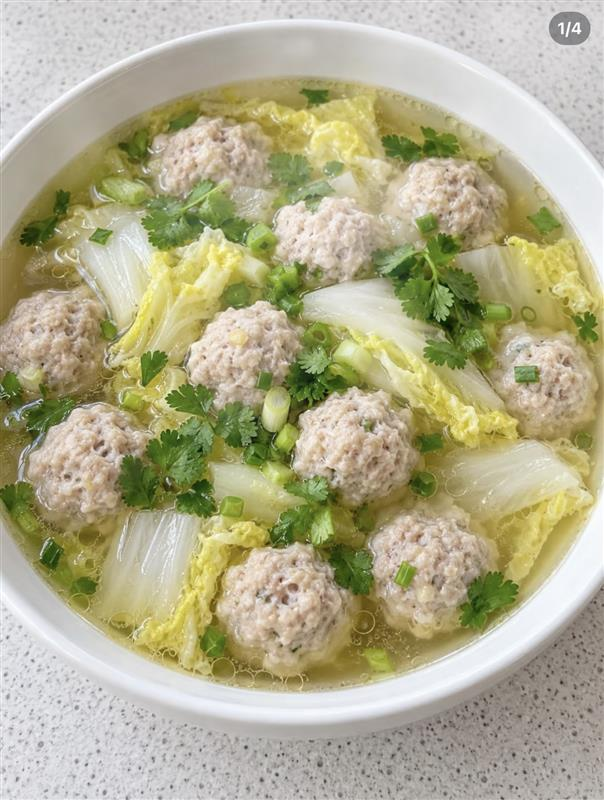

---
title: "肉丸蔬菜汤"

output:
  pdf_document:
    latex_engine: xelatex
    toc: false

documentclass: ctexart
classoption:
  - fontset=fandol

papersize: a4
geometry: margin=16mm
fontsize: 10pt

knit: |
  (function(input, ...) {
    root_dir <- dirname(dirname(normalizePath(input)))

    pdf_dir <- file.path(root_dir, "pdf", "pork")

    dir.create(
      pdf_dir,
      recursive = TRUE,
      showWarnings = FALSE
    )

    rmarkdown::render(
      input,
      output_format = "pdf_document",
      output_dir = pdf_dir
    )
  })
---

{width=70% fig-align="center"}
!(../image/pork-meatball2.jpg){width=70% fig-align="center"}

## 食材

| 食材 | 用量 |
  |---|---|
  | 猪肉馅 | 500 克 |
  | 葱姜 |少量 |
  | 鸡蛋 | 1个 |
  | 淀粉 | 2勺 |  
  | 盐 | 少许 |
  | 料酒 | 少许 |
  | 生抽 | 少许 |
  | 香油 | 少许 |

  
## 做法
  
  1️⃣ 葱姜加水抓出葱姜水（葱姜多泡一会儿）。肉馅放盆里，加鸡蛋，少许料酒，一点点生抽，盐，白胡椒粉，淀粉。 

  2️⃣ 顺着一个方向搅打上劲，分次少量加入葱姜水，每次搅匀吸收再加下一次，搅到肉馅粘稠，有弹性。最后淋一勺香油拌匀，静置10分钟。  
  
  3️⃣ 锅内放冷水或者温水，小火！水温微微冒小泡，还没沸腾的时候挤丸子：手抓肉馅，从虎口挤出肉球，勺子刮下来下锅。
  (⚠️！水不能大开，大火翻滚容易把丸子冲散)。 

  4️⃣ 全部挤完后，开中火慢慢升温，丸子浮起来基本就熟了，再煮2分钟。 
  
  5️⃣放青菜（小白菜，香菜，紫菜都行），加一点盐，白胡椒粉，关火，滴几滴香油。 

 