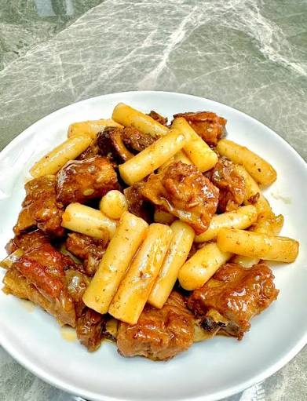

---
title: "排骨年糕"

output:
  pdf_document:
    latex_engine: xelatex
    toc: false

documentclass: ctexart
classoption:
  - fontset=fandol

papersize: a4
geometry: margin=16mm
fontsize: 10pt

knit: |
  (function(input, ...) {
    root_dir <- dirname(dirname(normalizePath(input)))

    pdf_dir <- file.path(root_dir, "pdf", "pork")

    dir.create(
      pdf_dir,
      recursive = TRUE,
      showWarnings = FALSE
    )

    rmarkdown::render(
      input,
      output_format = "pdf_document",
      output_dir = pdf_dir
    )
  })
---

{width=70% fig-align="center"}

## 食材

| 食材 | 用量 |
  |---|---|
  | 排骨 | 300 克 |
  | 年糕 | 200 克 |
  | 葱姜蒜 |少量 |
  | 糖 | 少许 |
  | 料酒 | 少许 |
  | 生抽 | 少许 |
  | 老抽 | 少许 |

  
## 做法
  
  1️⃣ 备菜：排骨年糕切好，葱姜蒜备好。 

  2️⃣ 焯水：排骨冷水下锅，加姜片，料酒焯水3分钟，捞出沥干。 
  
  3️⃣ 煎炒：热锅倒油，爆香葱姜蒜，下排骨炒至微黄，加生抽，老抽，糖调味。 

  4️⃣ 炖煮：加没过排骨的热水，大火烧开转小火炖20分钟，放入年糕再煮5分钟。  
  
  5️⃣ 出锅！撒上葱花！
  
## 好吃Tips：
* 年糕最后放，煮5分钟刚好，软糯不烂
* 最后可以大火收个汁，酱汁裹得更牢！
